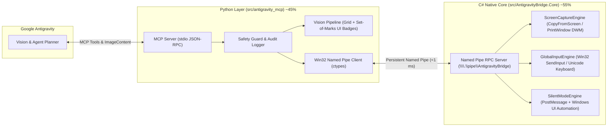

<div align="center">

# 🌌 Antigravity Computer-Use & Silent-Mode Bridge

**Hybrid C# (.NET 8 LTS) + Python MCP Gateway for Google Antigravity**

[-512BD4?logo=dotnet)](https://dotnet.microsoft.com/)
[](https://www.python.org/)
[](https://modelcontextprotocol.io/)
[-informational)](#архитектура--architecture)
[](LICENSE)

[**🇷🇺 Русская документация**](#-о-проекте-ru) | [**🇬🇧 English Documentation**](#-overview-en)

</div>

---

## 🇷🇺 О проекте (RU)

**Antigravity Bridge** — это высокопроизводительный гибридный шлюз-мостик (**~55% C# .NET 8 LTS + ~45% Python**), который дает **Google Antigravity** полноценное компьютерное зрение, управление мышью/клавиатурой и уникальный режим **Silent-Mode** для фоновой работы с внешними программами Windows без перехвата курсора и фокуса.

### ✨ Ключевые возможности

1. **👁️ Компьютерное зрение (Computer Vision + Set-of-Marks)**
   - Захват любого монитора или области экрана с поддержкой **Per-Monitor DPI Awareness v2**.
   - Наложение **координатной сетки `(X, Y)`** и маркера текущего положения курсора.
   - **Set-of-Marks (SoM) разметка UI**: автоматическое чтение дерева контролов Windows UI Automation и отрисовка нумерованных рамок `[1]`, `[2]`, `[3]` поверх кнопок и полей ввода.

2. **🖱️ Активное управление ПК (Hardware HID Input)**
   - Атомарный ввод через Win32 `SendInput`: клики (`left`, `right`, `middle`, `double_click`), `drag-and-drop`, скролл и плавная интерполяция движения мыши (`smoothstep`).
   - Аппаратный ввод текста на любом языке (**включая кириллицу и спецсимволы**) через `KEYEVENTF_UNICODE` без изменения буфера обмена пользователя.
   - Поддержка любых комбинаций горячих клавиш (`ctrl+shift+esc`, `alt+tab`, `win+r` и др.).
   - **Fail-Safe защита**: увод физического курсора мыши в левый верхний угол `(0, 0)` мгновенно блокирует управление.

3. **👻 Silent-Mode (Фоновая работа с внешними программами)**
   - **Фоновое зрение (`window_capture_silent`)**: делает скриншот конкретного окна (`HWND`) через `PrintWindow(PW_RENDERFULLCONTENT)`, даже если оно перекрыто другими окнами или находится на втором плане.
   - **Фоновые клики и ввод (`silent_click`, `silent_type`)**: отправляет `WM_LBUTTONDOWN`/`WM_LBUTTONUP`, `WM_CHAR`, `WM_KEYDOWN` напрямую в целевое окно (или дочерний контрол) через `PostMessage` — ваша мышь и активное окно остаются свободными.
   - **Нативная автоматизация контролов (`silent_automate_element`)**: нажимает кнопки, переключает чекбоксы и вводит текст в поля напрямую через паттерны **Windows UI Automation** (`InvokePattern`, `ValuePattern`, `TogglePattern`, `SelectionItemPattern`).

---

## 🏗️ Архитектура / Architecture



### Почему C# + Python?
- **C# (.NET 8.0 LTS `net8.0-windows`)**: нулевые внешние NuGet-зависимости, прямой доступ к `user32.dll` / `gdi32.dll`, встроенный движок `System.Windows.Automation` (UI Automation) и мгновенный захват экранных буферов.
- **Python (`antigravity_mcp`)**: нативная реализация **Model Context Protocol (MCP)**, быстрая отрисовка координатных сеток и UI-разметки (`Pillow`), управление жизненным циклом C#-ядра, аудит и политики безопасности.
- **Обход изоляции десктопов песочницы (`WinSta0` / `default`)**: C#-ядро автоматически привязывает рабочие потоки к интерактивному десктопу пользователя через `OpenDesktop("default")` + `SetThreadDesktop` (`Win32.EnsureDefaultDesktop()`), позволяя видеть реальный экран и окна даже при запуске MCP-сервера из изолированных песочниц (`exebox-*`).
- **Абсолютное позиционирование в DWM**: перемещение и клики мыши дублируются нормализованными пакетами `SendInput` (`MOUSEEVENTF_MOVE | MOUSEEVENTF_ABSOLUTE` в диапазоне `0..65535`) для гарантированной доставки событий в современные композитные окна Windows.
- 📄 **[Технический отчет живого тестирования (docs/dev_execution_log.md)](docs/dev_execution_log.md)** — полный лог прохождения сценария управления рабочим столом, меню «Пуск» и Блокнотом через MCP.

---

## 🛠️ Инструменты MCP / MCP Tools

| Инструмент / Tool | Режим / Mode | Описание / Description |
| :--- | :---: | :--- |
| `screen_capture` | Vision | Скриншот экрана/области с координатной сеткой `(X, Y)` и маркером курсора. |
| `window_capture_silent` | **Silent Vision** | Скриншот окна (`HWND`) в фоне без перехвата фокуса + разметка контролов `[1..N]`. |
| `list_windows` | Discovery | Список открытых окон (`HWND`, заголовок, процесс, размеры, статус). |
| `inspect_window_ui` | **Silent UIA** | Чтение дерева элементов окна через Windows UI Automation (`Button`, `Edit` и др.). |
| `mouse_action` | Active HID | Глобальные действия мыши (`click`, `double_click`, `right_click`, `move`, `drag`, `scroll`) по `(x, y)` или `ui_element_id`. |
| `keyboard_action` | Active HID | Ввод Unicode/кириллического текста (`KEYEVENTF_UNICODE`) и нажатие хоткеев (`ctrl+c` и др.). |
| `silent_click` | **Silent HID** | Фоновый клик по относительным координатам окна через `PostMessage` без движения курсора. |
| `silent_type` | **Silent HID** | Фоновый ввод текста (`WM_CHAR`) и клавиш (`WM_KEYDOWN`) в неактивное окно. |
| `silent_automate_element` | **Silent UIA** | Вызов `InvokePattern` / `ValuePattern` / `TogglePattern` у элемента окна в фоне. |
| `manage_window` | Window Mgmt | Управление состоянием окна (`focus`, `minimize`, `maximize`, `restore`, `show_no_activate`, `close`, `move_resize`). |

---

## 🚀 Быстрый старт / Quick Start

### 1. Требования / Prerequisites
- **Windows 10 / 11**
- **.NET 8.0 SDK** (`dotnet --version`)
- **Python 3.10+** (`python --version`) + `pip install pillow` (опционально для рисования сетки и рамок)

### 2. Сборка нативного C#-ядра / Build the C# Core
```powershell
dotnet build src/AntigravityBridge.Core/AntigravityBridge.Core.csproj -c Release
```

### 3. Проверка и запуск тестов / Run Smoke Tests
```powershell
python tests/test_bridge.py
```

### 4. Подключение в Google Antigravity / Connect to Google Antigravity
Добавьте конфигурацию из [`mcp_config.example.json`](mcp_config.example.json) в настройки MCP-серверов Google Antigravity:

```json
{
  "mcpServers": {
    "antigravity-bridge": {
      "command": "python",
      "args": ["-m", "antigravity_mcp.server"],
      "env": {
        "PYTHONPATH": "C:/Users/fara/Desktop/Antigravity/src"
      }
    }
  }
}
```
> Python-сервер автоматически запускает скомпилированный `AntigravityBridge.Core.exe` в фоновом режиме (без консольного окна) и держит постоянное соединение по каналу `\\.\pipe\AntigravityBridge`.

---

## 🇬🇧 Overview (EN)

**Antigravity Bridge** is a hybrid **C# (.NET 8 LTS) + Python** Model Context Protocol (MCP) gateway designed for **Google Antigravity** on Windows.

- **Computer Vision**: Full-screen and region capture with coordinate grids, cursor crosshairs, and **Set-of-Marks (`[1..N]`)** UI element bounding boxes.
- **Computer Use (HID)**: Smooth mouse control and hardware Unicode keyboard entry (`KEYEVENTF_UNICODE`) with `(0,0)` corner Fail-Safe protection.
- **Silent-Mode External App Automation**: Capture background windows via `PrintWindow(PW_RENDERFULLCONTENT)` and interact with them via Win32 `PostMessage` or **Windows UI Automation (`InvokePattern`, `ValuePattern`)** without stealing window focus or moving the user's physical mouse cursor.

---

## 📂 Структура проекта / Project Structure

```text
Antigravity/
├── .agents/skills/antigravity-bridge/
│   └── SKILL.md                      # Инструкции (Skill) для агента Google Antigravity
├── src/
│   ├── AntigravityBridge.Core/       # [C# .NET 8 LTS] Нативное ядро Windows (55%)
│   │   ├── Capture/                  # Захват экрана и фоновых окон (PrintWindow / DWM)
│   │   ├── Input/                    # Глобальный ввод SendInput (мышь + Unicode клавиатура)
│   │   ├── Silent/                   # Silent-Mode: PostMessage + Windows UI Automation
│   │   ├── Ipc/                      # Сервер JSON-RPC поверх Windows Named Pipes
│   │   ├── Models/                   # Контракты данных IPC
│   │   └── Native/                   # Декларации P/Invoke (user32, gdi32)
│   └── antigravity_mcp/              # [Python] MCP-сервер и конвейер зрения (45%)
│       ├── server.py                 # MCP stdio сервер и маршрутизация инструментов
│       ├── core_client.py            # Win32 Named Pipe клиент и менеджер процесса C#
│       ├── vision.py                 # Сетка координат и Set-of-Marks разметка (Pillow)
│       └── safety.py                 # Аудит вызовов, лимиты частоты и защита процессов
├── tests/
│   └── test_bridge.py                # Интеграционные тесты Python <-> Named Pipe <-> C#
├── mcp_config.example.json           # Пример конфигурации MCP для Antigravity
├── LICENSE                           # MIT License
└── README.md                         # Документация проекта (RU / EN)
```
