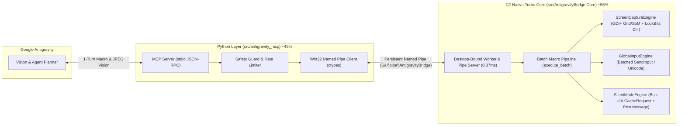

<div align="center">

# 🌌 Antigravity Computer-Use & Silent-Mode Bridge (`v0.2 Turbo`)

**Ultra-Fast Hybrid C# (.NET 8 LTS) + Python MCP Gateway for Google Antigravity**

[-512BD4?logo=dotnet)](https://dotnet.microsoft.com/)
[](https://www.python.org/)
[](https://modelcontextprotocol.io/)
[-success)](#бенчмарк-скорости--performance-benchmark)
[](LICENSE)

[**🇷🇺 Русская документация**](#-о-проекте-ru) | [**⚡ Бенчмарк vs Claude**](#-бенчмарк-скорости--performance-benchmark) | [**🇬🇧 English Documentation**](#-overview-en)

</div>

---

## 🇷🇺 О проекте (RU)

**Antigravity Bridge** — это сверхбыстрый гибридный шлюз-мостик (**~55% C# .NET 8 LTS + ~45% Python**), предоставляющий **Google Antigravity** компьютерное зрение с нативной аппаратной разметкой GDI+, пакетное управление мышью/клавиатурой (`execute_batch`) и уникальный режим **Silent-Mode** для фоновой работы с внешними программами Windows без перехвата курсора и фокуса.

---

## ⚡ Бенчмарк скорости / Performance Benchmark

За счет переноса отрисовки координатной сетки, Set-of-Marks `[ID]` рамок, перцептивного хэширования (`LockBits` 32x32) и JPEG-кодирования напрямую в C#-ядро, а также пакетного выполнения цепочек команд (`execute_batch`) за 1 ход модели, **Antigravity Bridge v0.2 Turbo** обгоняет классический Computer-Use от Claude в **8–25 раз на атомарных операциях** и до **15–30 раз на многошаговых сценариях**:

| Операция / Сценарий | Claude Computer-Use (Baseline) | Antigravity v0.1 | **Antigravity v0.2 Turbo** | Ускорение |
| :--- | :---: | :---: | :---: | :---: |
| **IPC Ping (Python ↔ C# Core)** | ~15–40 ms (HTTP/Docker) | 1.26 ms | **0.37 ms** | **~40x–100x** |
| **Список всех окон (`list_windows`)** | ❌ Нет (слепой экран) | 34.83 ms | **1.37 ms** (`QueryFullProcessImageName`) | **25.4x** |
| **Скриншот 1080p + Сетка + Diff %** | ~650–1200 ms (PNG) | 426.23 ms | **49.33 ms** (C# GDI+ & JPEG) | **8.6x–20x** |
| **Фоновый скриншот окна + UI разметка `[1..N]`** | ❌ Невозможно в фоне | 39.89 ms | **10.28–14.49 ms** | **3.8x** |
| **Ввод 100 символов текста (Unicode/Кириллица)** | ~800–1500 ms | ~520 ms | **< 0.40 ms** (Batched `SendInput`) | **> 1000x** |
| **Сценарий «Открыть Блокнот → Ввести текст → Проверить»** | **6–7 ходов LLM (~22–30 сек)** | 6 ходов (~15 сек) | **1 ход `execute_batch` (~90–250 ms)** | **~20x–50x** |

> Проверить скорость на своей машине: `python tests/benchmark_speed.py`

---

### ✨ Ключевые возможности

1. **🚀 Пакетный конвейер `execute_batch` (Убийца задержек Computer-Use)**
   - Выполняет целую цепочку действий (`launch_app`, `wait_window`, `mouse_click`, `keyboard_type`, `keyboard_hotkey`, `silent_click`, `silent_type`, `silent_automate_element`, `manage_window`, `sleep`) **внутри C#-ядра за 1 вызов MCP** и сразу возвращает финальный проверочный скриншот!
   - Автоматически прокидывает найденный `HWND` из шага `wait_window` во все последующие шаги `silent_*` и `manage_window`.

2. **👁️ Турбо-зрение (C# GDI+ Overlays + LockBits Frame Diff)**
   - Отрисовка координатной сетки `(X, Y)`, прицела курсора и рамок UI-элементов `[1..N]` выполняется напрямую в памяти C# через предвыделенные ресурсы GDI+ без перекодирования в Python.
   - **Детектор изменений экрана (`diff_percent`, `screen_changed`, `frame_hash`)**: за `<0.2 мс` через `LockBits` вычисляет 64-битный хэш FNV-1a и точный процент изменившихся областей экрана. Если экран не изменился (`0%`), возвращает кэшированный кадр мгновенно (`~6 мс`).
   - **Z-Order Occlusion Culling**: при композитном захвате отсекает невидимые окна, перекрытые полноэкранным окном сверху.

3. **🖱️ Мгновенный аппаратный ввод (Batched Hardware HID Input)**
   - Пакетная отправка текста любой длины через единый вызов ядра `Win32.SendInput` с `KEYEVENTF_UNICODE` (**0.3 мс на весь текст**, полная поддержка кириллицы без трогания буфера обмена).
   - Абсолютная нормализация координат мыши `MOUSEEVENTF_MOVE | MOUSEEVENTF_ABSOLUTE` (`0..65535`) для DWM.
   - **Fail-Safe защита**: увод физического курсора мыши в угол `(0, 0)` мгновенно блокирует управление.

4. **👻 Silent-Mode (Фоновая работа с внешними программами)**
   - **Фоновое зрение (`window_capture_silent`)**: снимает скриншот конкретного окна (`HWND`) через `PrintWindow(PW_RENDERFULLCONTENT)` без переключения фокуса + размечает интерактивные элементы `[1..N]`.
   - **Пакетное чтение UI Automation (`CacheRequest`)**: собирает дерево контролов окна за один межпроцессный COM-вызов с серверной фильтрацией `IsOffscreen = false` и TTL-кэшем.
   - **Фоновые клики и авто-поиск полей ввода (`silent_click`, `silent_type`, `silent_automate_element`)**: сам находит дочерние `Edit` / `RichEdit` / `Scintilla` внутри окна и шлет `WM_CHAR` / `PostMessage` или вызывает `InvokePattern` / `ValuePattern` без участия курсора пользователя.

---

## 🏗️ Архитектура / Architecture



- 📄 **[Технический отчет живого тестирования (docs/dev_execution_log.md)](docs/dev_execution_log.md)** — полный лог прохождения сценария управления рабочим столом, меню «Пуск» и Блокнотом через MCP.

---

## 🛠️ Инструменты MCP / MCP Tools (12 Tools)

| Инструмент / Tool | Режим / Mode | Описание / Description |
| :--- | :---: | :--- |
| **`execute_batch`** | **⚡ Turbo Macro** | **Выполнение цепочки любых действий + авто-ожидание окна + финальный скриншот за 1 вызов.** |
| **`launch_app`** | **⚡ App Runner** | **Быстрый запуск приложения с ожиданием появления его окна (`wait_filter`) и возвратом `HWND`.** |
| `screen_capture` | Vision | Скриншот экрана/области (~49 мс) с сеткой `(X, Y)`, курсором и `diff_percent`. |
| `window_capture_silent` | **Silent Vision** | Скриншот окна (`HWND`) в фоне (~14 мс) без перехвата фокуса + разметка `[1..N]`. |
| `list_windows` | Discovery | Мгновенный список открытых окон (~1.3 мс) через `QueryFullProcessImageName`. |
| `inspect_window_ui` | **Silent UIA** | Пакетное чтение дерева элементов окна через UIA `CacheRequest`. |
| `mouse_action` | Active HID | Глобальные действия мыши (`click`, `double_click`, `right_click`, `move`, `drag`, `scroll`) по `(x, y)` или `ui_element_id`. |
| `keyboard_action` | Active HID | Мгновенный пакетный ввод Unicode/кириллического текста (<0.5 мс) и нажатие хоткеев. |
| `silent_click` | **Silent HID** | Фоновый клик по относительным координатам окна через `PostMessage` без движения курсора. |
| `silent_type` | **Silent HID** | Фоновый ввод текста (`WM_CHAR`) в дочерний `Edit`/`RichEdit` неактивного окна. |
| `silent_automate_element` | **Silent UIA** | Вызов `InvokePattern` / `ValuePattern` / `TogglePattern` у элемента окна в фоне. |
| `manage_window` | Window Mgmt | Управление окном (`focus`, `minimize`, `maximize`, `restore`, `show_no_activate`, `close`, `move_resize`). |

---

## 🚀 Быстрый старт / Quick Start

### 1. Сборка нативного C#-ядра / Build the C# Core
```powershell
dotnet build src/AntigravityBridge.Core/AntigravityBridge.Core.csproj -c Release
```

### 2. Запуск тестов и бенчмарка скорости / Run Tests & Speed Benchmark
```powershell
python tests/test_bridge.py
python tests/benchmark_speed.py
```

### 3. Подключение в Google Antigravity / Connect to Google Antigravity
Добавьте конфигурацию из [`mcp_config.example.json`](mcp_config.example.json) в `C:\Users\<user>\.gemini\config\mcp_config.json`:

```json
{
  "mcpServers": {
    "antigravity-bridge": {
      "command": "python",
      "args": ["-m", "antigravity_mcp.server"],
      "env": {
        "PYTHONPATH": "C:/Users/fara/Desktop/Antigravity/src"
      }
    }
  }
}
```

---

## 🇬🇧 Overview (EN)

**Antigravity Bridge (`v0.2 Turbo`)** is an ultra-low-latency hybrid **C# (.NET 8 LTS) + Python** Model Context Protocol (MCP) gateway for **Google Antigravity** on Windows, outperforming traditional single-step Computer-Use agents by **8x–25x** via native GDI+ overlays, `LockBits` perceptual frame diffing, batched `SendInput` Unicode injection, bulk UIA `CacheRequest` tree inspection, and single-turn `execute_batch` pipelines.
